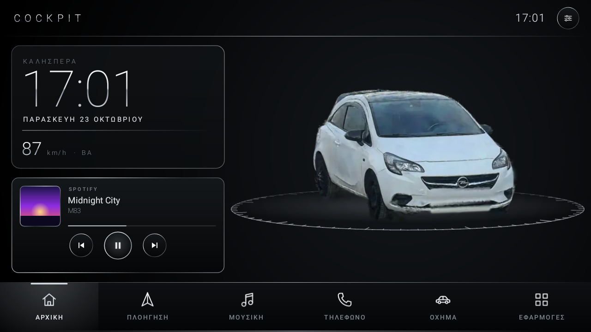
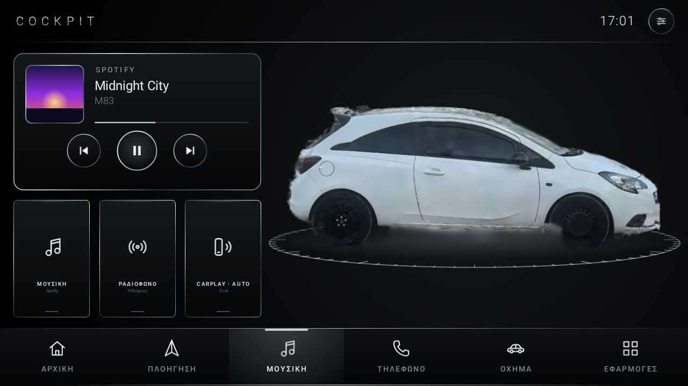
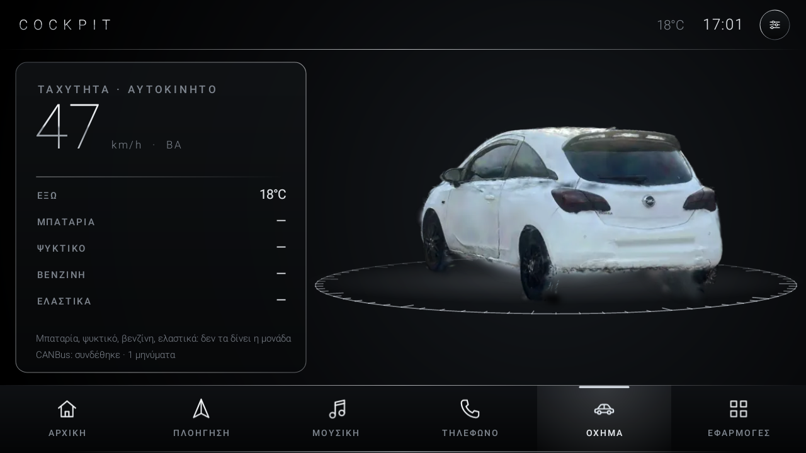
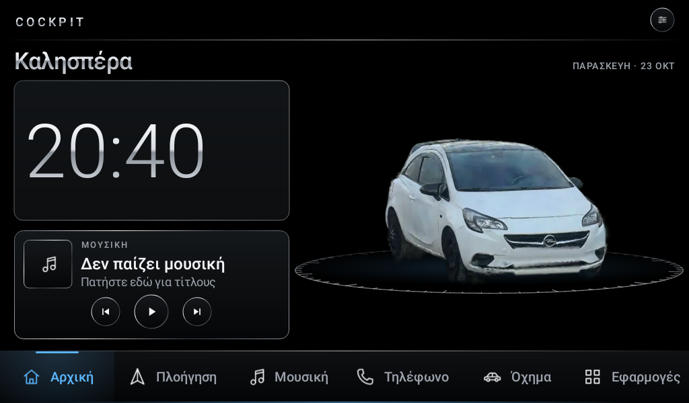
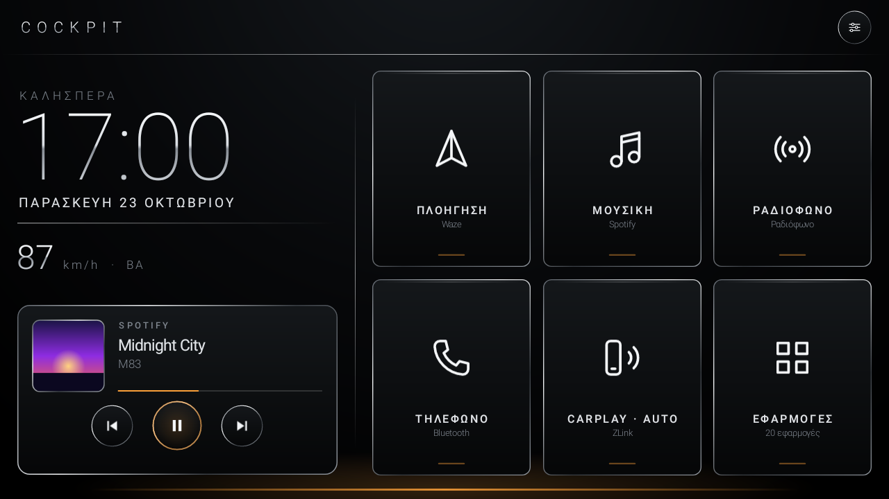

# Cockpit

Ελαφρύς launcher (αρχική οθόνη) για Android οθόνες αυτοκινήτου, με στήσιμο luxury SUV: μαύρο γυαλί,
γυαλισμένες ασημί γραμμές, το αυτοκίνητο σε 3D στο κέντρο και φωτισμός ατμόσφαιρας. Φτιαγμένος για το
**Digital iQ RTC 5486_CPA (9")** σε Opel Corsa E, αλλά τρέχει σε κάθε Android head unit από Android 6 και πάνω.

Η ιδέα είναι ίδια με το [cleanyourtv](https://github.com/Gathin23/cleanyourtv): στη θέση της βαριάς
αρχικής οθόνης του κατασκευαστή μπαίνει ένας μικρός native launcher.



| | |
|---|---|
|  |  |
| *Μουσική: το αυτοκίνητο γυρίζει και δείχνει τη δεξιά πλευρά* | *Όχημα: από πίσω, ταχύτητα GPS* |
|  |  |
| *Οθόνη 1024x600, φωτισμός «παγωμένο μπλε»* | *«Εμφάνιση αυτοκινήτου: Όχι», τα απλά πλακίδια* |

<sub>Τα screenshots είναι από headless rendering του ίδιου του κώδικα με δοκιμαστικές εφαρμογές. Το
αυτοκίνητο είναι προσωρινό μοντέλο από γραμμές με τις διαστάσεις του Corsa E· θα το αντικαταστήσει
σκανάρισμα του πραγματικού αυτοκινήτου.</sub>

## Γιατί είναι γρήγορος

- **~80 KB APK.** Καμία βιβλιοθήκη (ούτε AndroidX, ούτε Kotlin), μόνο τα views του Android και Canvas.
- **Τίποτα στο παρασκήνιο.** Ρολόι, μουσική και GPS διαβάζονται μόνο όσο φαίνεται η αρχική οθόνη.
- **Χωρίς internet, διαφημίσεις ή analytics.** Δεν ζητάει καν άδεια internet.
- Η λίστα εφαρμογών και τα εικονίδια φορτώνουν σε δικό τους thread, η οθόνη ανοίγει αμέσως μαύρη.

## Τι κάνει

- **Καρτέλες με το αυτοκίνητο:** Αρχική (βλέπεις «μούρη»), Μουσική (δεξιά πλευρά), Όχημα (από πίσω). Σε κάθε
  αλλαγή γυρίζει ομαλά· γυρίζει και με το δάχτυλο. Το Home ή το Back σε φέρνουν πάντα στην Αρχική.
  **Ρυθμίσεις → Εμφάνιση αυτοκινήτου: Όχι** γυρίζει στα απλά πλακίδια.
- **Πλακίδια και μπάρα:** Πλοήγηση, Μουσική, Ραδιόφωνο, Τηλέφωνο, CarPlay · Auto, Εφαρμογές. Βρίσκει μόνο
  του την εφαρμογή για το καθένα (Waze ή Google Maps, Spotify ή το player της μονάδας, ραδιόφωνο και
  Bluetooth της μονάδας, ZLink ή AutoKit). **Κρατήστε πατημένο** ένα πλακίδιο για να διαλέξετε άλλη.
- **Ρολόι, ημερομηνία και χαιρετισμός** σε λεπτά ασημί ψηφία.
- **Κάρτα μουσικής:** προηγούμενο, αναπαραγωγή/παύση, επόμενο για όποιο player παίζει. Με την
  «Πληροφορίες μουσικής» ενεργή δείχνει και τίτλο, καλλιτέχνη, εξώφυλλο και πρόοδο.
- **Ταχύτητα GPS και κατεύθυνση** (προαιρετικά), π.χ. `87 km/h · ΒΑ`.
- **Φωτισμός ατμόσφαιρας:** ασημί, παγωμένο μπλε, κεχριμπάρι, κόκκινο, βιολετί.
- **Δικό σας όνομα στην μπάρα** (π.χ. τη μάρκα του αυτοκινήτου).
- **Όλες οι εφαρμογές** σε πλέγμα. Παρατεταμένο πάτημα ανοίγει τις πληροφορίες εφαρμογής (απεγκατάσταση κ.λπ.).
- Προσαρμόζεται σε κάθε ανάλυση (1024x600, 1280x720, 1920x720…) και σε κάθετη οθόνη.

## Εγκατάσταση

1. Κατεβάστε το **Cockpit.apk** από τα [Releases](../../releases/latest) (χτίζεται αυτόματα σε κάθε αλλαγή).
2. Αντιγράψτε το σε ένα USB stick, βάλτε το στη μονάδα και ανοίξτε το από τον διαχειριστή αρχείων.
   Αν ζητηθεί, επιτρέψτε την εγκατάσταση από «άγνωστες πηγές».
3. Πατήστε **Home** και διαλέξτε **Cockpit → Πάντα**. Αν δεν εμφανιστεί επιλογή, ανοίξτε το Cockpit
   από τη λίστα εφαρμογών και πηγαίνετε **Ρυθμίσεις → Αρχική οθόνη**.
4. Προαιρετικά, στις Ρυθμίσεις του Cockpit (εικονίδιο πάνω δεξιά):
   - **Πληροφορίες μουσικής** → ενεργοποιήστε το Cockpit στην πρόσβαση ειδοποιήσεων. Χρησιμοποιείται
     μόνο για να βλέπει ποιο τραγούδι παίζει· καμία ειδοποίηση δεν διαβάζεται.
   - **Ταχύτητα GPS** → επιτρέψτε την τοποθεσία.

**Με υπολογιστή και ADB** (καλώδιο ή ασύρματο debugging) τα κάνει όλα μαζί:

```sh
tools/install.sh Cockpit.apk
```

### Επιστροφή στον αρχικό launcher

Ρυθμίσεις συστήματος → Εφαρμογές → Προεπιλεγμένες εφαρμογές → Αρχική εφαρμογή → ο αρχικός launcher.
Ή απλώς απεγκατάσταση του Cockpit. Τίποτα από το σύστημα της μονάδας δεν αλλάζει ούτε απενεργοποιείται.

### Σημειώσεις για head units

- **Μην απενεργοποιήσετε τον launcher του κατασκευαστή.** Σε πολλές μονάδες εκεί ζουν το ραδιόφωνο, το
  Bluetooth ή η επικοινωνία με το αυτοκίνητο. Το Cockpit απλώς μπαίνει μπροστά του.
- Κάποιες μονάδες ανοίγουν τον δικό τους launcher στην εκκίνηση. Ένα πάτημα στο Home φέρνει το Cockpit.
- Αν η μονάδα κρύβει την οθόνη «πρόσβαση ειδοποιήσεων», το Cockpit δείχνει την εντολή ADB που την ενεργοποιεί.
- Αν κάποιο πλακίδιο ανοίγει λάθος εφαρμογή, κρατήστε το πατημένο και διαλέξτε τη σωστή.
  **Ρυθμίσεις → Πλακίδια** τα επαναφέρει όλα στην αυτόματη επιλογή.

## Build

Κάθε push χτίζει το APK στο GitHub Actions και ενημερώνει το release `latest`
([.github/workflows/apk.yml](.github/workflows/apk.yml)).

Τοπικά, με JDK 17 και Android SDK:

```sh
./gradlew assembleRelease
# app/build/outputs/apk/release/app-release.apk
```

Το APK υπογράφεται με το `app/sideload.keystore` που βρίσκεται στο repo, ώστε κάθε νέα έκδοση να
εγκαθίσταται πάνω στην προηγούμενη χωρίς απεγκατάσταση. Δεν είναι μυστικό· αν θέλετε δικό σας κλειδί,
αντικαταστήστε το και τους κωδικούς στο `app/build.gradle`.

## Κώδικας

Όλα είναι στο `app/src/main/java/com/mahunity/launcher/`:

| Αρχείο | Τι κάνει |
|---|---|
| `HomeActivity` | Η αρχική οθόνη, τα φύλλα «Εφαρμογές» και «Ρυθμίσεις», τα κλικ. |
| `HomeLayout` | Η απλή αρχική (χωρίς αυτοκίνητο), σε αναλογίες της οθόνης. |
| `Chrome` | Παλέτα, γραμματοσειρές και τα «μεταλλικά» gradients. |
| `CockpitLayout`, `DockBar`, `VehicleView` | Η αρχική με το αυτοκίνητο, η μπάρα και η καρτέλα Όχημα. |
| `CarView`, `CarModel` | Το αυτοκίνητο στην περιστροφική βάση και το μοντέλο του σε γραμμές. |
| `TileView`, `ClockView`, `MediaCard`, `TopBar` | Τα κομμάτια της αρχικής, ζωγραφισμένα με Canvas. |
| `Slots` | Ποια εφαρμογή ανοίγει κάθε πλακίδιο και πώς τη μαντεύει. |
| `Apps` | Λίστα εφαρμογών και εικονίδια, εκτός main thread. |
| `MediaWatcher`, `MediaListener` | Ο player που παίζει και τα πλήκτρα πολυμέσων. |
| `SpeedWatcher` | Ταχύτητα και κατεύθυνση από το GPS. |

Τα εικονίδια είναι vector drawables στο `res/drawable/`, ζωγραφισμένα λευκά· η εφαρμογή τα βάφει ασημί
ή στο χρώμα του φωτισμού.
