# Cockpit

Ελαφρύς launcher (αρχική οθόνη) για Android οθόνες αυτοκινήτου: μεγάλα γράμματα και εικονίδια που
διαβάζονται με μια ματιά, μαύρο με ασημί πλαίσια ή διάφανο γυαλί, το αυτοκίνητο σε 3D στο κέντρο και φωτισμός
ατμόσφαιρας στο χρώμα της επιλογής σας. Φτιαγμένος για το
**Digital iQ RTC 5486_CPA (9")** σε Opel Corsa E, αλλά τρέχει σε κάθε Android head unit από Android 6 και πάνω.

Η ιδέα είναι ίδια με το [cleanyourtv](https://github.com/Gathin23/cleanyourtv): στη θέση της βαριάς
αρχικής οθόνης του κατασκευαστή μπαίνει ένας μικρός native launcher.


| | |
|---|---|
|  |  |
| *Μουσική: το αυτοκίνητο γυρίζει και δείχνει τη δεξιά πλευρά* | *Όχημα: από πίσω, με τα δεδομένα του CANBus* |
| 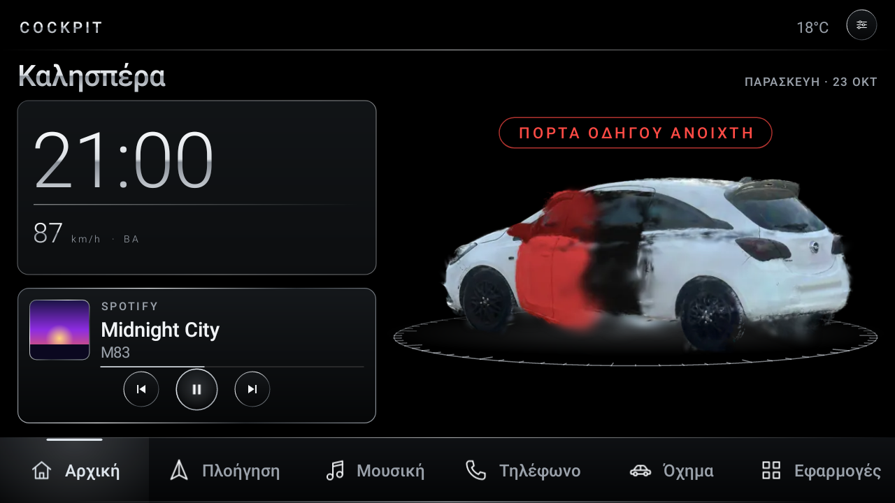 | 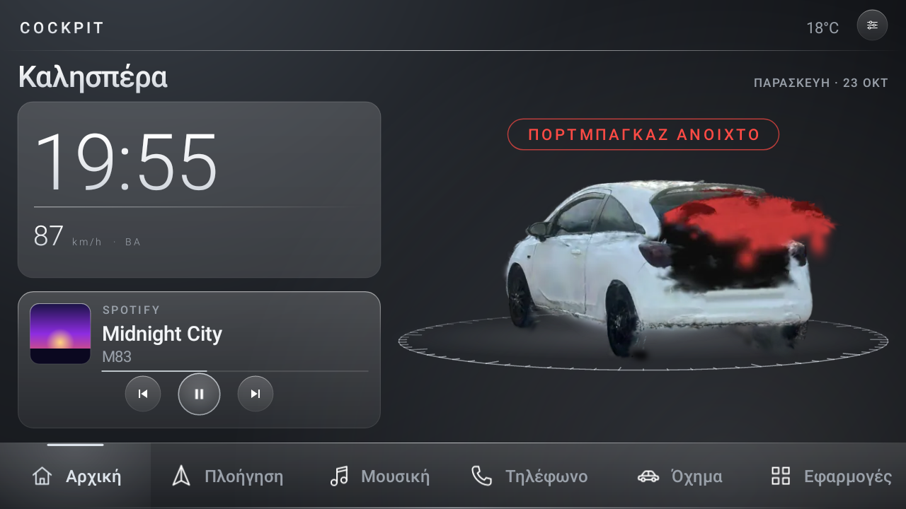 |
| *Ανοίγει η πόρτα του οδηγού: το αυτοκίνητο γυρίζει, την ανοίγει σε κόκκινο και το λέει* | *Το ίδιο για το πορτμπαγκάζ (και το καπό)* |
| 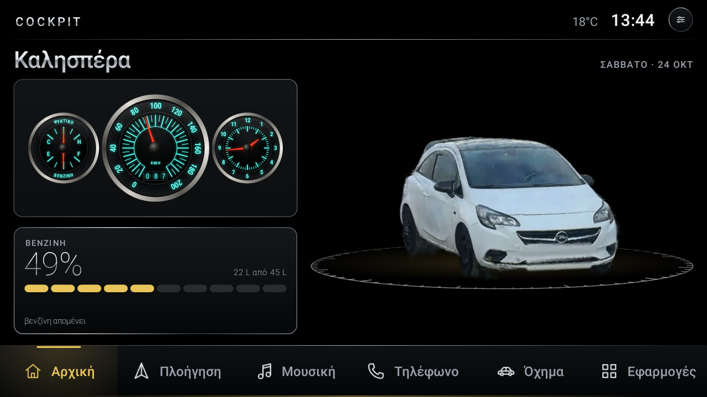 | 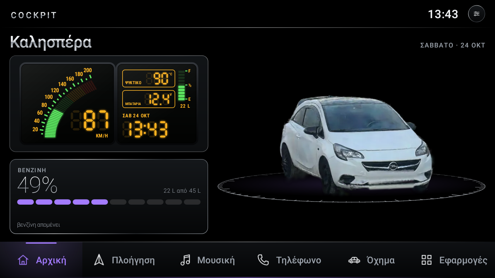 |
| *Ταχύμετρο 60s · Charger, όπως ένα Charger του '66 τη νύχτα: ψυκτικό και βενζίνη, ταχύμετρο, ρολόι. Κάτω η βενζίνη (22 από 45 λίτρα), χρώμα «χρυσό»* | *Ψηφιακό 80s · Corvette, όπως η Corvette C4: ταχύμετρο αριστερά· ψυκτικό, μπαταρία, βενζίνη και ώρα δεξιά* |
| 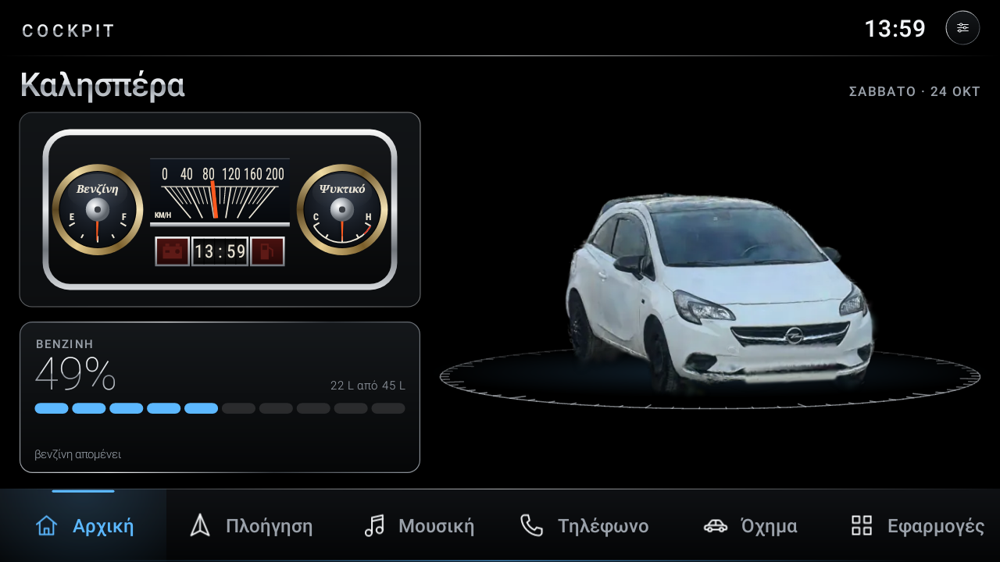 | 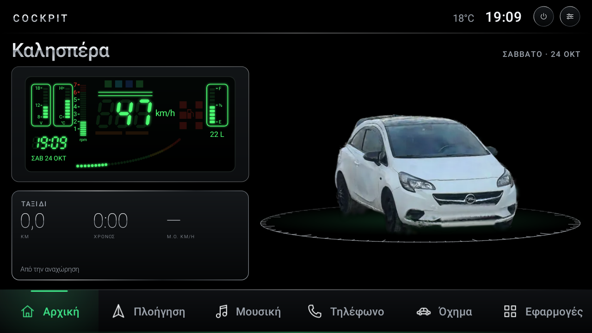 |
| *Ταχύμετρο 60s · Mustang, όπως η Mustang του '65: οριζόντια ταινία, βενζίνη και ψυκτικό σε χρυσά στεφάνια, η ώρα σε τύμπανο* | *Ψηφιακό 80s · ιαπωνικό, πράσινη οθόνη VFD: η ταχύτητα σε ψηφία και σε γραμμή από κουκκίδες, μπαταρία, ψυκτικό, βενζίνη, ώρα* |
| 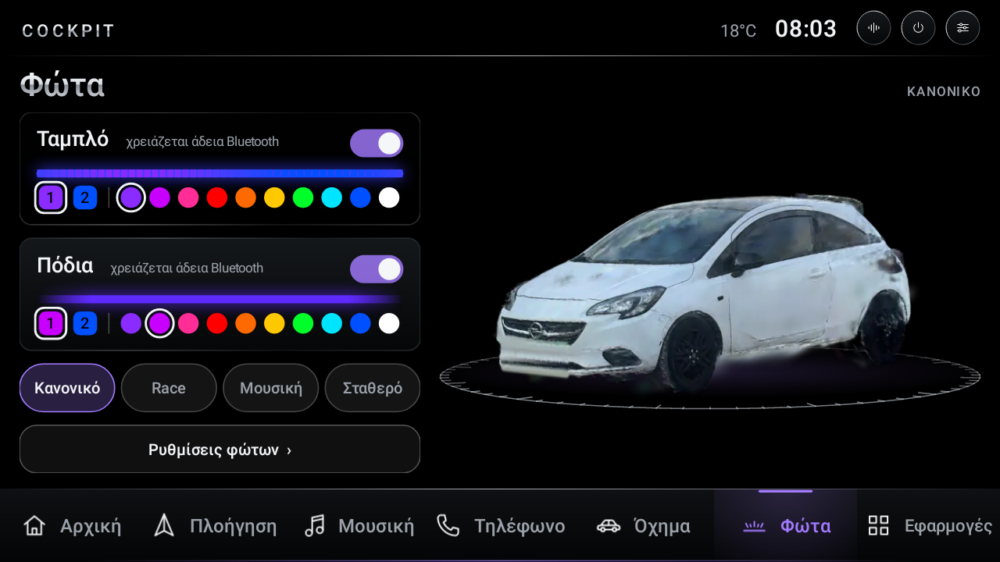 |  |
| *Καρτέλα Φώτα: το ταμπλό στις 2600 στροφές, τα πόδια με 6 λίτρα βενζίνη (κόκκινο-πορτοκαλί)* | *Όχημα: στροφές, μπαταρία, ψυκτικό, βενζίνη, ελαστικά* |
| 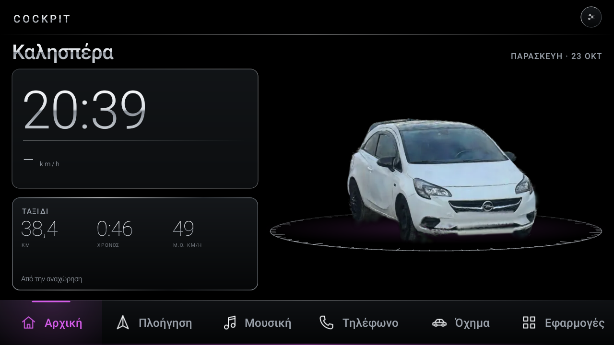 | 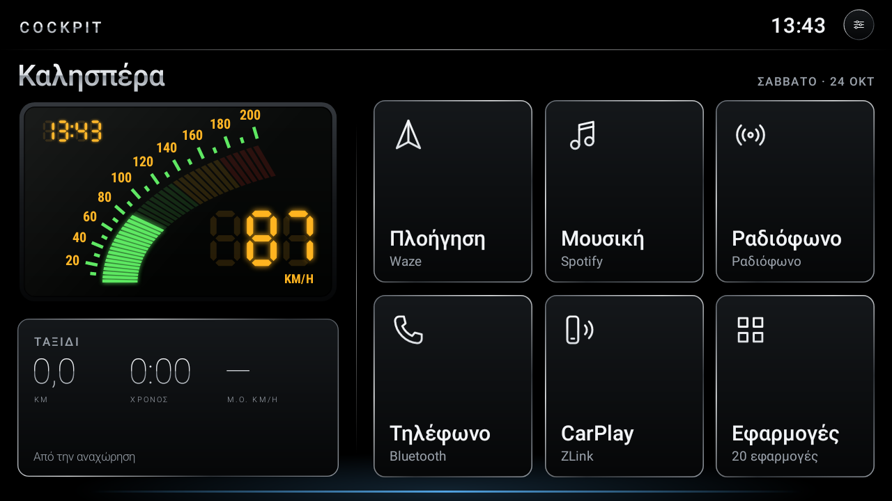 |
| *Ρολόι και ταξίδι, χρώμα «μωβ»* | *Χωρίς αυτοκίνητο, με το ψηφιακό 80s* |
| 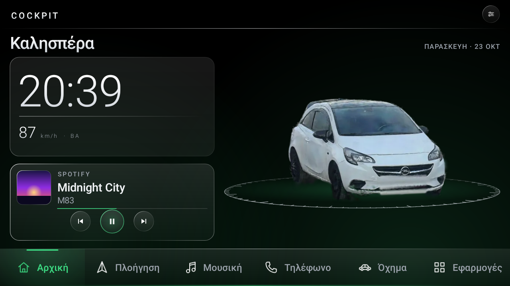 | 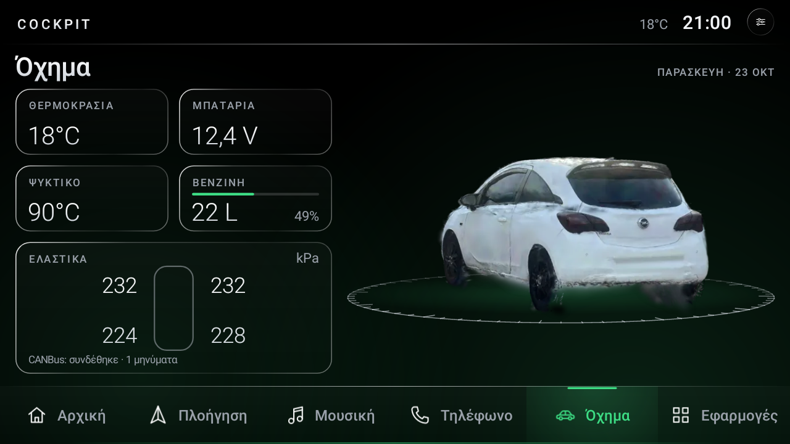 |
| *Στυλ εμφάνισης «Γυαλί»: διάφανες κάρτες, από μέσα φαίνεται το φως ατμόσφαιρας* | *Όχημα: στροφές, μπαταρία, ψυκτικό, βενζίνη και τα τέσσερα ελαστικά* |
|  |  |
| *Οθόνη 1024x600, χρώμα «παγωμένο μπλε»* | *«Εμφάνιση αυτοκινήτου: Όχι», τα απλά πλακίδια* |

<sub>Τα screenshots είναι από headless rendering του ίδιου του κώδικα με δοκιμαστικές εφαρμογές και
δοκιμαστικά δεδομένα CANBus. Το αυτοκίνητο είναι φωτογραφίες από σκανάρισμα του πραγματικού αυτοκινήτου,
καθαρισμένο και χωρίς πινακίδες ([tools/car](tools/car/README.md)).</sub>

## Γιατί είναι γρήγορος

- **~3,7 MB APK**, από τα οποία ο κώδικας είναι ~140 KB και τα υπόλοιπα οι φωτογραφίες του αυτοκινήτου.
  Καμία βιβλιοθήκη (ούτε AndroidX, ούτε Kotlin), μόνο τα views του Android και Canvas.
- **Το αυτοκίνητο φορτώνει λίγες φωτογραφίες τη φορά**, σε δικό του thread, και ζωγραφίζεται μόνο όσο γυρίζει.
- **Σχεδόν τίποτα στο παρασκήνιο.** Ρολόι, μουσική και GPS διαβάζονται μόνο όσο φαίνεται η αρχική οθόνη.
  Μένουν μόνο η σύνδεση με το CANBus (πόρτες, και η ταχύτητα για το ταξίδι) και η ανάγνωση των στοιχείων της
  Car Info, με ένα μέτρημα το δευτερόλεπτο.
- **Χωρίς internet, διαφημίσεις ή analytics.** Δεν ζητάει καν άδεια internet.
- Η λίστα εφαρμογών και τα εικονίδια φορτώνουν σε δικό τους thread, η οθόνη ανοίγει αμέσως μαύρη.

## Τι κάνει

- **Καρτέλες με το αυτοκίνητο:** Αρχική (βλέπεις «μούρη»), Μουσική (δεξιά πλευρά), Όχημα (από πίσω). Σε κάθε
  αλλαγή γυρίζει ομαλά· γυρίζει και με το δάχτυλο. Το Home ή το Back σε φέρνουν πάντα στην Αρχική.
  **Ρυθμίσεις → Εμφάνιση αυτοκινήτου: Όχι** γυρίζει στα απλά πλακίδια, και **Στυλ αυτοκινήτου** αλλάζει
  ανάμεσα σε φωτογραφία και ολόγραμμα από γραμμές.
- **Δύο στυλ εμφάνισης** (Ρυθμίσεις → Στυλ εμφάνισης): **Κλασικό**, μαύρο με γυαλισμένα ασημί πλαίσια, ή
  **Γυαλί**, διάφανες κάρτες με φωτεινό περίγραμμα όπως στο iPhone. **Γυαλί: διαφάνεια** από 0 (εντελώς
  διάφανο, φαίνεται μόνο το περίγραμμα) έως 10 (θολό, frosted). **Φόντο:** μαύρο, σκούρο ή ανοιχτό γκρι.
- **Πλήρης οθόνη:** χωρίς τη γραμμή κατάστασης του Android· ώρα και θερμοκρασία είναι στην μπάρα του Cockpit.
  Ένα σύρσιμο από την πάνω άκρη τη φέρνει για λίγο.
- **Σβήσιμο οθόνης και DSP:** πάνω δεξιά, δίπλα στις Ρυθμίσεις. Το ⏻ σβήνει την οθόνη όπως το κουμπί του
  launcher της NWD· ένα άγγιγμα την ανάβει ξανά. Το DSP ανοίγει τις ρυθμίσεις ήχου της NWD (DSP, ισοσταθμιστής).
  Εμφανίζονται μόνο σε μονάδες NWD.
- **Πλακίδια και μπάρα:** Πλοήγηση, Μουσική, Ραδιόφωνο, Τηλέφωνο, CarPlay, Εφαρμογές. Βρίσκει μόνο
  του την εφαρμογή για το καθένα (Waze ή Google Maps, Spotify ή το player της μονάδας, ραδιόφωνο και
  Bluetooth της μονάδας, ZLink ή AutoKit). Στις μονάδες NWD βρίσκει και το ραδιόφωνο, το τηλέφωνο και το
  ZLink, που δεν έχουν δικό τους εικονίδιο στη λίστα εφαρμογών. **Κρατήστε πατημένο** ένα πλακίδιο για να
  διαλέξετε άλλη.
- **Widgets στην Αρχική, από τις Ρυθμίσεις:**
  - **Επάνω widget:** ρολόι σε μεγάλα ψηφία, ή ένα από τέσσερα όργανα: **ταχύμετρο 60s** σε ύφος Charger ή
    Mustang, **ψηφιακό 80s** σε ύφος Corvette ή ιαπωνικό. Όλα έχουν και **στροφόμετρο** ως τις 7000 στροφές,
    κόκκινο από τις 6000.
    - **Ταχύμετρο 60s · Charger:** όπως το Charger του '66 τη νύχτα. Τιρκουάζ αριθμοί και γραμμές φωτίζουν σε μαύρο
      φόντο, οι βελόνες είναι λεπτές και κόκκινες, και κάθε όργανο έχει χρωμέ στεφάνι όπως σε Mustang ή Bel
      Air. Έχει τρία όργανα:
      - αριστερά, ψυκτικό (C–H) επάνω και βενζίνη (E–F) κάτω, όπως το αμπερόμετρο και η βενζίνη του
        Charger· χωρίς δεδομένα, οι βελόνες μένουν στο C και στο E·
      - στη μέση, το ταχύμετρο, με την ταχύτητα στο παραθυράκι του χιλιομετρητή·
      - δεξιά, το στροφόμετρο (×1000), με την ώρα στο δικό του παραθυράκι.

      Όταν δεν χωράνε τρία, μένει μόνο το ταχύμετρο, με την ώρα στο παραθυράκι.
    - **Ταχύμετρο 60s · Mustang:** όπως η Mustang του '65, σε μαύρο πάνελ με χρωμέ πλαίσιο.
      - Στη μέση, το ταχύμετρο-ταινία: ψηλοί, στενοί αριθμοί πάνω από μια βεντάλια από λοξές γραμμές, και μια
        πορτοκαλί βελόνα που τρέχει οριζόντια.
      - Αριστερά, σε χρυσό στεφάνι, το ψυκτικό (C–H) επάνω και η βενζίνη (E–F) κάτω, με το όνομά τους σε
        πλάγια γράμματα. Δεξιά, το στροφόμετρο, όπως το Rally Pac της εποχής.
      - Κάτω από την ταινία, τρία παραθυράκια: μια λυχνία που ανάβει κόκκινη όταν η μπαταρία πέφτει κάτω από
        11,8 V, η ώρα σε τύμπανο, και μια λυχνία που ανάβει όταν η βενζίνη πέφτει κάτω από 12%.

      Όταν δεν χωράνε τα στρογγυλά όργανα, μένουν η ταινία και τα παραθυράκια.
    - **Ψηφιακό 80s · Corvette:** όπως η Corvette C4, με οθόνες υγρών κρυστάλλων πίσω από φιμέ τζάμι.
      - Αριστερά, το ταχύμετρο: μια πράσινη μπάρα ανεβαίνει και λυγίζει προς τα δεξιά, γίνεται πορτοκαλί
        μετά τα 130 και κόκκινη μετά τα 170. Δίπλα έχει πορτοκαλί αριθμούς, και η ταχύτητα φαίνεται σε μεγάλα
        ψηφία επτά τμημάτων.
      - Στη μέση, όπως η μεσαία οθόνη της C4: πλαίσια για το ψυκτικό και την μπαταρία, η μπάρα της βενζίνης
        (E, ½, F, με τα λίτρα) και η ώρα.
      - Δεξιά, το στροφόμετρο: η ίδια μπάρα, πορτοκαλί από τις 4500 και κόκκινη από τις 6000, και οι στροφές
        σε εκατοντάδες (20 = 2000), όπως στη C4.
      - Τα σβηστά τμήματα φαίνονται αχνά, όπως στο πραγματικό.

      Σε στενότερο χώρο μένουν ταχύμετρο και στροφόμετρο· σε ακόμα στενότερο, μόνο το ταχύμετρο, με την ώρα
      στη γωνία.
    - **Ψηφιακό 80s · ιαπωνικό:** όπως οι πράσινες οθόνες VFD των ιαπωνικών κουπέ της εποχής.
      - Στη μέση, η ταχύτητα σε μεγάλα πλάγια ψηφία. Από κάτω, η μπάρα ορίου ταχύτητας ανάβει πορτοκαλί από
        τα 130 km/h.
      - Μια γραμμή από κουκκίδες ανεβαίνει με την ταχύτητα: πράσινη, μετά κίτρινη, πορτοκαλί και κόκκινη.
      - Δίπλα στα ψηφία, το στροφόμετρο: μια κάθετη στήλη με τα 1 έως 7 (×1000), κόκκινη από τις 6000.
      - Αριστερά, πλαίσια με μπάρες για την μπαταρία (8–18 V) και το ψυκτικό, και από κάτω η ώρα με την
        ημερομηνία.
      - Δεξιά, η βενζίνη (F, ½, E) με τα λίτρα, και η λυχνία της αντλίας, που ανάβει κόκκινη όταν η βενζίνη
        πέφτει κάτω από 12%.

      Όταν ο χώρος είναι στενός, μένουν η ταχύτητα, οι κουκκίδες, το στροφόμετρο και η ώρα.
  - **Κάτω widget:** μουσική, **βενζίνη** (ποσοστό και λίτρα από το σύνολο του ρεζερβουάρ, π.χ. 22 από
    45 L = 49%· η Car Info δίνει ακέραια λίτρα), **πίεση ελαστικών** ή **ταξίδι** (απόσταση, χρόνος και μέση ταχύτητα από την εκκίνηση· νέο
    ταξίδι όταν το αυτοκίνητο ξεκινά μετά από 10 λεπτά ακινησίας).
  - **Ρεζερβουάρ:** 45 λίτρα από προεπιλογή.
- **Πόρτες:** όταν ανοίγει πόρτα, πορτμπαγκάζ ή καπό, το αυτοκίνητο γυρίζει προς τα εκεί, την ανοίγει σε 3D
  βαμμένη κόκκινη και γράφει π.χ. «Πόρτα οδηγού ανοιχτή». Όταν κλείσει, γυρίζει πίσω. Το δικό της παράθυρο
  πορτών η Car Info το βγάζει πάνω από όλα· κλείνει με μία εντολή ADB
  ([παρακάτω](#το-παράθυρο-πορτών-της-car-info)).
- **Φώτα LED (καρτέλα Φώτα):** το Cockpit ελέγχει μόνο του, μέσω Bluetooth LE, τη λωρίδα LED στο **ταμπλό** και
  αυτές στα **πόδια**. Στην καρτέλα: διακόπτης και χρώματα για την καθεμιά (δύο, «1» και «2», όπου η λειτουργία
  θέλει δύο), μια μπάρα που δείχνει τι ανάβει εκείνη τη στιγμή, και η λειτουργία:
  - **Κανονικό:** κάθε λωρίδα περνάει αργά από το ένα της χρώμα στο άλλο και πίσω (π.χ. μπλε και μωβ).
  - **Race:** το ταμπλό δείχνει τις στροφές. Κανονικά όλο μαζί σε ένα χρώμα (πράσινο → κόκκινο → μωβ). Με ένα
    πάτημα στην κάρτα Ταμπλό γίνεται **μπάρα στροφών** LED προς LED, όπως στα τιμόνια των αγωνιστικών: στο ρελαντί ανάβει πράσινη
    η αριστερή άκρη, όσο ανεβαίνουν οι στροφές γεμίζει προς τα δεξιά, κόκκινη στη μέση, μωβ στο τέλος, και στο
    όριο αναβοσβήνει ολόκληρη σαν shift light. Τα πόδια μένουν στο χρώμα τους και αναβοσβήνουν κόκκινα όταν
    φρενάρετε (από το πόσο γρήγορα πέφτει η ταχύτητα· το αυτοκίνητο δεν στέλνει σήμα φρένου).
  - **Μουσική:** το ταμπλό γεμίζει από αριστερά με την ένταση της μουσικής, από το πρώτο χρώμα στο δεύτερο· τα
    πόδια χτυπούν με το μπάσο, που θέλει πιο δυνατό χτύπημα για να φανεί. Ακούει ό,τι παίζει η μονάδα μέσω
    Android (εφαρμογές, μουσική από USB) ή το μικρόφωνο, για ό,τι δεν περνάει από το Android (σε πολλές μονάδες
    το ραδιόφωνο). Θέλει την άδεια μικροφώνου, που ζητιέται όταν τη διαλέξετε.
  - **Σταθερό:** το πρώτο χρώμα της καθεμιάς.
  - **Βενζίνη στα πόδια:** στο Κανονικό και στο Σταθερό, το κουμπάκι με την αντλία δίπλα στα χρώματα των ποδιών
    τα βάζει να δείχνουν τη βενζίνη: κόκκινο ως 5 L, μπλε ως 15 L, μωβ ως 29 L, πράσινο από εκεί και πάνω. Ένα
    χρώμα από την παλέτα τους το κλείνει.

  Το LED προς LED θέλει λωρίδα addressable («symphony») σε χειριστήριο ZENGGE, ρυθμισμένη σε ένα τμήμα
  (segment) στην εφαρμογή ZENGGE. Στα **IOTBT** είναι ανάποδα: η εντολή E1 03 δίνει χρώμα ανά τμήμα,
  οπότε κάθε τμήμα είναι ένα βήμα της μπάρας (π.χ. 20 τμήματα των 10 LED για λωρίδα 200 LED). Όσα βήματα δεν
  χωράνε σε μία αποστολή, η μπάρα απλώνεται σε όσα χωράνε. Η **Μπάρα στροφών: σχήμα** τη γεμίζει από αριστερά
  προς τα δεξιά, από τις άκρες στη μέση ή όλο το ταμπλό σε ένα χρώμα. Αν το ταμπλό είναι δύο λωρίδες και η δεξιά
  είναι τοποθετημένη ανάποδα, το **Ταμπλό: δεξί κομμάτι → Τοποθετημένο ανάποδα** το διορθώνει, και το **Ταμπλό: LED της
  αριστερής λωρίδας** λέει πού τελειώνει η αριστερή (αν δεν είναι στη μέση). Η **Μπάρα στροφών: εύρεση βημάτων**
  ανάβει ένα βήμα τη φορά, για να βρείτε πού πέφτει το καθένα. Στις λειτουργίες με ένα χρώμα, μια τέτοια λωρίδα παίρνει
  το ίδιο χρώμα σε κάθε τμήμα, για να μη μένει κανένα πίσω. Το Cockpit διαβάζει το μοντέλο του χειριστηρίου όταν το διαλέγετε και στέλνει
  χρώμα για κάθε LED με την εντολή που παίρνει: **E1 03** στα νεότερα (0x53, 0x56, 0xAA και μετά) ή **59** στα
  παλαιότερα (0xA1–0xA9). Οποιαδήποτε άλλη λωρίδα αλλάζει χρώμα ολόκληρη.

  Στις **Ρυθμίσεις φώτων** διαλέγετε τις συσκευές (σάρωση Bluetooth), τη λειτουργία, τη φωτεινότητα, πόσο
  γρήγορα κινείται το Κανονικό, τι ακούει η Μουσική και με τι ευαισθησία, το όριο στροφών, από πού αρχίζει η
  μπάρα (800 rpm), πόσα LED έχει (αν το χειριστήριο δεν το πει), με ποια εντολή ανάβει LED προς LED, και πόσο
  απότομο πρέπει να είναι το φρενάρισμα. Η **Μπάρα στροφών: δοκιμή** την τρέχει μία φορά ως το όριο. Η
  **Κατάσταση** δείχνει το μοντέλο, το MTU, πόσα LED είπε το χειριστήριο και τις απαντήσεις του. Τα φώτα
  ακολουθούν το αυτοκίνητο και όταν μπροστά είναι άλλη εφαρμογή. Υποστηρίζονται τα χειριστήρια **ZENGGE**
  (LEDnetWF), **ELK-BLEDOM** (Lotus Lantern, Duoco Strip και τα περισσότερα κιτ για τα πόδια), **Triones** και
  **Magic Home BLE** (HappyLighting). Κάθε χειριστήριο δέχεται μία σύνδεση τη φορά: κλείστε τη δική του
  εφαρμογή, και στο κινητό.
- **Κάρτα μουσικής:** προηγούμενο, αναπαραγωγή/παύση, επόμενο για όποιο player παίζει. Με την
  «Πληροφορίες μουσικής» ενεργή δείχνει και τίτλο, καλλιτέχνη, εξώφυλλο και πρόοδο. Το **ραδιόφωνο** και η
  **μουσική από USB** της NWD δεν έχουν media session, οπότε η κάρτα τα παίρνει από τα μηνύματα που στέλνουν
  στα widgets του launcher της NWD, όταν είναι η τρέχουσα πηγή της μονάδας: τη συχνότητα (π.χ. FM 101.7) με
  προηγούμενο/επόμενο σταθμό από τις μνήμες, ή τίτλο, καλλιτέχνη και πρόοδο. Για αυτά δεν χρειάζεται η
  «Πληροφορίες μουσικής».
- **Καρτέλα Όχημα:** στροφές, τάση μπαταρίας, θερμοκρασία ψυκτικού, βενζίνη (λίτρα και ποσοστό) και η πίεση
  και των τεσσάρων ελαστικών γύρω από μια κάτοψη του αυτοκινήτου (σε kPa, όπως η Car Info· σε psi αν το
  αυτοκίνητο είναι ρυθμισμένο έτσι). **Ρυθμίσεις → Κατάσταση CANBus** δείχνει από κάτω τη σύνδεση και πόσα
  μηνύματα έχουν έρθει (κλειστό από προεπιλογή).
- **CANBus (μονάδες NWD, όπως η Digital iQ):** η υπηρεσία CAN της μονάδας δίνει σε άλλες εφαρμογές ταχύτητα,
  στροφές και πόρτες/πορτμπαγκάζ/καπό. Τις στροφές η Car Info τις παίρνει από τη δεύτερη, «κοινή» πηγή της (ο
  αποκωδικοποιητής του Corsa δεν τις στέλνει) και τις βάζει στο ίδιο πακέτο με την ταχύτητα. Βενζίνη,
  μπαταρία, ψυκτικό, πιέσεις ελαστικών και θερμοκρασία έξω τα δείχνει μόνο η δική της εφαρμογή, η **Car
  Info**· το Cockpit τα διαβάζει από το log της ([παρακάτω](#βενζίνη-μπαταρία-ψυκτικό-tpms)), χωρίς να αγγίζει
  το CANBus. (Τη θερμοκρασία έξω η Car Info τη στέλνει και η ίδια, αλλά μόνο όταν αλλάζει, οπότε ένα Cockpit
  που ξεκίνησε μετά δεν την άκουγε.) Μόνο ανάγνωση: το Cockpit δεν στέλνει τίποτα προς το αυτοκίνητο.
- **Ταχύτητα GPS και κατεύθυνση** (προαιρετικά), π.χ. `87 km/h · ΒΑ`.
- **Χρώμα έμφασης:** ασημί, παγωμένο μπλε, κεχριμπάρι, κόκκινο, βιολετί, πράσινο, χρυσό, μωβ, τιρκουάζ,
  ροζ, λευκό.
- **Δικό σας όνομα στην μπάρα** (π.χ. τη μάρκα του αυτοκινήτου).
- **Όλες οι εφαρμογές** σε πλέγμα. Παρατεταμένο πάτημα ανοίγει τις πληροφορίες εφαρμογής (απεγκατάσταση κ.λπ.).
- Προσαρμόζεται σε κάθε ανάλυση (1024x600, 1280x720, 1920x720…) και σε κάθετη οθόνη.

## Εγκατάσταση

1. Κατεβάστε το **Cockpit.apk** από τα [Releases](../../releases/latest) (χτίζεται αυτόματα σε κάθε αλλαγή).
2. Αντιγράψτε το σε ένα USB stick, βάλτε το στη μονάδα και ανοίξτε το από τον διαχειριστή αρχείων.
   Αν ζητηθεί, επιτρέψτε την εγκατάσταση από «άγνωστες πηγές».
3. Πατήστε **Home** και διαλέξτε **Cockpit → Πάντα**. Αν δεν εμφανιστεί επιλογή, ανοίξτε το Cockpit
   από τη λίστα εφαρμογών και πηγαίνετε **Ρυθμίσεις → Αρχική οθόνη**.
   **Στις μονάδες NWD** αυτό δεν αρκεί: η μονάδα ανοίγει τον launcher που ορίζουν οι δικές της ρυθμίσεις, ό,τι
   κι αν λέει το Android. Ανοίξτε τις **Ρυθμίσεις αυτοκινήτου** της NWD, πηγαίνετε στη σελίδα με την
   προεπιλεγμένη ένταση και τον χρόνο σβησίματος οθόνης, και στο **Default launcher** διαλέξτε **Cockpit**
   («System theme» είναι ο αρχικός). Το Cockpit το καταλαβαίνει: η **Ρυθμίσεις → Αρχική οθόνη** δείχνει
   «Προεπιλογή ✓» μόνο όταν συμφωνούν και τα δύο, αλλιώς εξηγεί πού είναι η ρύθμιση και ανοίγει τις
   Ρυθμίσεις αυτοκινήτου.
4. Προαιρετικά, στις Ρυθμίσεις του Cockpit (εικονίδιο πάνω δεξιά):
   - **Πληροφορίες μουσικής** → ενεργοποιήστε το Cockpit στην πρόσβαση ειδοποιήσεων. Χρησιμοποιείται
     μόνο για να βλέπει ποιο τραγούδι παίζει· από τις ειδοποιήσεις κοιτάζει μόνο αυτή του player («τώρα παίζει»).
   - **Ταχύτητα GPS** → επιτρέψτε την τοποθεσία.

**Με υπολογιστή και ADB** (καλώδιο ή ασύρματο debugging) τα κάνει όλα μαζί:

```sh
tools/install.sh Cockpit.apk
```

### Βενζίνη, μπαταρία, ψυκτικό, TPMS

Η Car Info της NWD παίρνει αυτά τα στοιχεία από το CANBus και, με τον διακόπτη αποσφαλμάτωσης που ανάβει το
Cockpit, γράφει κάθε μήνυμα στο log του συστήματος. Το Cockpit κρατάει από εκεί μόνο τα μηνύματα που τα
περιέχουν, και αυτό του κλιματισμού για τη θερμοκρασία έξω. Το Android αφήνει μια εφαρμογή να διαβάζει αυτό το log μόνο με μια άδεια που δίνεται **μία φορά από
ADB**:

```sh
adb shell pm grant com.mahunity.launcher android.permission.READ_LOGS
```

(το `tools/install.sh` το κάνει μόνο του). Η Car Info δείχνει ένα σύντομο μήνυμα («debugState…») κάθε φορά
που το Cockpit ανάβει την καταγραφή της· το Cockpit το κάνει μόνο όταν χρειάζεται. Για να μην εμφανίζεται ποτέ,
η Car Info μπορεί να καταγράφει μόνη της από κάθε εκκίνηση (και αυτό το κάνει το `tools/install.sh`):

```sh
adb shell settings put system canapp_debug 1
```

Σε Android 13 και μετά, κάθε φορά που ξεκινά η μονάδα το σύστημα
ρωτάει αν το Cockpit μπορεί να δει τα logs: **Να επιτρέπεται**. Η κατάσταση φαίνεται στις
**Ρυθμίσεις → Δεδομένα Car Info**.

**Χωρίς υπολογιστή**, από ένα κινητό Android (με iPhone δεν γίνεται):

1. Στη μονάδα: Ρυθμίσεις → Σχετικά → 7 πατήματα στον «Αριθμό έκδοσης», μετά Επιλογές προγραμματιστή →
   **Ασύρματος εντοπισμός σφαλμάτων**. Μονάδα και κινητό στο ίδιο Wi-Fi (π.χ. το hotspot του κινητού).
2. Στο κινητό, μια εφαρμογή ADB (π.χ. **Bugjaeger**): σύζευξη με τον κωδικό που δείχνει η μονάδα.
3. Στο shell της: `pm grant com.mahunity.launcher android.permission.READ_LOGS`

### Το παράθυρο πορτών της Car Info

Όταν ανοίγει μια πόρτα, η Car Info βγάζει στη μέση της οθόνης δικό της παράθυρο με το αυτοκίνητο από πάνω. Το
Cockpit δείχνει ήδη την ανοιχτή πόρτα στο δικό του αυτοκίνητο, οπότε το παράθυρο περισσεύει. Η Car Info το
παραλείπει όταν μια ρύθμιση συστήματος είναι 1. Αυτή γράφεται μόνο από ADB, μία φορά, και μένει (εκτός αν γίνει
επαναφορά της Car Info):

```sh
adb shell settings put system car_config_door_not_show 1
```

Με 0 ξαναεμφανίζεται. Το `tools/install.sh` το κάνει μόνο του, και η κατάσταση φαίνεται στις
**Ρυθμίσεις → Παράθυρο πορτών NWD**.

### Επιστροφή στον αρχικό launcher

Ρυθμίσεις συστήματος → Εφαρμογές → Προεπιλεγμένες εφαρμογές → Αρχική εφαρμογή → ο αρχικός launcher.
Ή απλώς απεγκατάσταση του Cockpit. Τίποτα από το σύστημα της μονάδας δεν αλλάζει ούτε απενεργοποιείται.

### Σημειώσεις για head units

- **Μην απενεργοποιήσετε τον launcher του κατασκευαστή.** Σε πολλές μονάδες εκεί ζουν το ραδιόφωνο, το
  Bluetooth ή η επικοινωνία με το αυτοκίνητο. Το Cockpit απλώς μπαίνει μπροστά του.
- Κάποιες μονάδες ανοίγουν τον δικό τους launcher στην εκκίνηση. Στις NWD διορθώνεται από τις Ρυθμίσεις
  αυτοκινήτου (βλ. Εγκατάσταση, βήμα 3)· αλλού, ένα πάτημα στο Home φέρνει το Cockpit.
- Αν η μονάδα κρύβει την οθόνη «πρόσβαση ειδοποιήσεων», το Cockpit δείχνει την εντολή ADB που την ενεργοποιεί.
- Αν κάποιο πλακίδιο ανοίγει λάθος εφαρμογή, κρατήστε το πατημένο και διαλέξτε τη σωστή.
  **Ρυθμίσεις → Πλακίδια** τα επαναφέρει όλα στην αυτόματη επιλογή.

## Build

Κάθε push χτίζει το APK στο GitHub Actions και ενημερώνει το release `latest`
([.github/workflows/apk.yml](.github/workflows/apk.yml)).

Τοπικά, με JDK 17 και Android SDK:

```sh
./gradlew assembleRelease
# app/build/outputs/apk/release/app-release.apk
```

Το APK υπογράφεται με το `app/sideload.keystore` που βρίσκεται στο repo, ώστε κάθε νέα έκδοση να
εγκαθίσταται πάνω στην προηγούμενη χωρίς απεγκατάσταση. Δεν είναι μυστικό· αν θέλετε δικό σας κλειδί,
αντικαταστήστε το και τους κωδικούς στο `app/build.gradle`.

## Κώδικας

Όλα είναι στο `app/src/main/java/com/mahunity/launcher/`:

| Αρχείο | Τι κάνει |
|---|---|
| `HomeActivity` | Η αρχική οθόνη, τα φύλλα «Εφαρμογές» και «Ρυθμίσεις», τα κλικ. |
| `HomeLayout` | Η απλή αρχική (χωρίς αυτοκίνητο), σε αναλογίες της οθόνης. |
| `Chrome` | Παλέτα, μεγέθη γραμμάτων και οι επιφάνειες των δύο στυλ (Κλασικό, Γυαλί). |
| `CockpitLayout`, `DockBar`, `VehicleView` | Η αρχική με το αυτοκίνητο, η μπάρα και η καρτέλα Όχημα. |
| `GaugeView`, `Gauge60`, `GaugeRibbon`, `Gauge80`, `GaugeVfd`, `Figures` | Τα τέσσερα όργανα της αρχικής και τα ψηφία επτά τμημάτων τους. |
| `InfoCard`, `FuelCard`, `TyreCard`, `TripCard` | Τα κάτω widgets της αρχικής. |
| `Trip` | Απόσταση και χρόνος ταξιδιού από την ταχύτητα. |
| `CarView`, `CarFrames` | Το αυτοκίνητο στην περιστροφική βάση, οι φωτογραφίες του από το σκανάρισμα και οι πόρτες που ανοίγουν. |
| `CarModel` | Το αυτοκίνητο σε γραμμές («Ολόγραμμα» στις Ρυθμίσεις). |
| `TileView`, `ClockView`, `MediaCard`, `TopBar`, `Header` | Τα κομμάτια της αρχικής, ζωγραφισμένα με Canvas. |
| `Slots` | Ποια εφαρμογή ανοίγει κάθε πλακίδιο και πώς τη μαντεύει. |
| `Apps` | Λίστα εφαρμογών και εικονίδια, εκτός main thread. |
| `MediaWatcher`, `MediaListener` | Ο player που παίζει και τα πλήκτρα πολυμέσων. |
| `NwdMedia` | Το ραδιόφωνο και η μουσική (USB) της NWD, που δεν έχουν media session. |
| `LedStrips`, `LedProtocol` | Οι λωρίδες LED μέσω Bluetooth LE: σάρωση, σύνδεση και οι εντολές κάθε τύπου χειριστηρίου. |
| `Ambient`, `LightsView`, `LightsSettings` | Τι χρώμα δείχνουν οι λωρίδες σε κάθε λειτουργία, η καρτέλα Φώτα και οι Ρυθμίσεις φώτων. |
| `Sound` | Η ένταση και το μπάσο της μουσικής για τη λειτουργία Μουσική, από ό,τι παίζει η μονάδα ή από το μικρόφωνο. |
| `SpeedWatcher` | Ταχύτητα και κατεύθυνση από το GPS. |
| `CanBus` | Ταχύτητα, στροφές και πόρτες από την υπηρεσία CAN της NWD (Binder). |
| `NwdLog` | Βενζίνη, μπαταρία, ψυκτικό, TPMS και θερμοκρασία έξω από το log της Car Info. |

Τα εικονίδια είναι vector drawables στο `res/drawable/`, ζωγραφισμένα λευκά· η εφαρμογή τα βάφει ασημί
ή στο χρώμα έμφασης.
